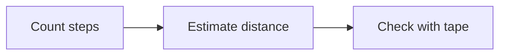

# Three walks across the courtyard

There is a line of blue tiles outside the library. At one end a brass strip crosses the path. At the other, twelve metres away, someone has set a coin into the paving. On Tuesday we used the two marks to put a length to an ordinary step.

## The morning notebook

One person walked. Another stood by the coin and kept count. The rule was simple enough to remember on the way back to the start.[^step]

| Crossing | Steps | In the margin |
| --- | ---: | --- |
| First | 16 | Looking down at the tiles |
| Second | 17 | Short last step |
| Third | 15 | Looking at the library door |

### Before the next walk

- [x] Measure between the two marks with a tape.
- [x] Write down each count before walking back.
- [ ] Repeat with a bag of books.

::: note The last step
If the coin falls between two footfalls, use the nearer one. Keep that choice for every crossing.
:::

[^step]: Count each footfall, left or right. Here a stride would cover two steps.

## A length to take away

Put the three walks end to end on paper. Let $D$ be the total distance and $N$ the number of steps. Dividing once gives each step the same weight, even on the crossing that took seventeen.

$$
\begin{aligned}
D &= 3 \times 12 = 36\,\mathrm{m} \\
N &= 16 + 17 + 15 = 48 \\
D / N &= 36 / 48 = 0.75\,\mathrm{m}
\end{aligned}
$$

### A pocket calculation

A second reader can check the arithmetic from the three counts. The distance in the first line is for one crossing.

```swift
let metres = 12.0
let counts = [16, 17, 15]
let distance = metres * Double(counts.count)
let step = distance / Double(counts.reduce(0, +))
```

The notebook now has a rough ruler in it. Forty steps on similar ground would cover about thirty metres. The short step by the coin is a reason to keep the word *about*.

## Beyond the blue tiles

At the back of the library the path turns towards a bench. This time we left the tape rolled up until the end. The order matters: once you know the distance, it is hard to walk quite as you did before.



Estimate
: The step count multiplied by the length from the courtyard.
Difference
: The estimate minus the tape reading. Keep the sign so the next reader can tell which was longer.

There is room in the margin for a return trip. A count in the opposite direction would be a better note to bring back than an extra decimal place.[^surface]

## Try

- Choose another style.
- Switch to Spread.
- Press Print to see the print screen.
- Print a booklet and fold it in half.

[^surface]: Note the surface too. A step on gravel may be shorter than a step on those tiles.
