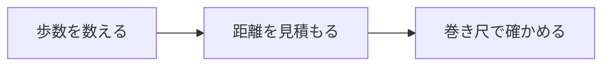

# 中庭を三度歩く

図書館の前に、青いタイルを敷いた小道がある。片端に真鍮の帯が一本、そこから十二メートル先には古い硬貨が埋めてある。火曜の朝、この二つを目印に、いつもの一歩がどのくらいの長さか測ってみた。

## 朝の野帳

一人が歩き、もう一人が硬貨のそばで歩数を数えた。戻ってから数字を取り違えないように、渡り切るたびに{野帳|やちょう}を開いた。[^step]

| 回 | 歩数 | 余白に書いたこと |
| --- | ---: | --- |
| 一回目 | 16 | 足元のタイルを見ていた |
| 二回目 | 17 | 最後の一歩が小さい |
| 三回目 | 15 | 図書館の扉を見ていた |

### 次に歩くまでに

- [x] 目印と目印の間を巻き尺で測る
- [x] 引き返す前に歩数を書き留める
- [ ] 本を入れた鞄を持って、もう一度歩く

::: note 最後の一歩
硬貨をまたいだら、その手前と先の足跡のうち、硬貨に近い方までを数える。三回とも同じ決め方にする。
:::

[^step]: 左右どちらの足も、地面に着くたびに一歩と数えた。

## 一歩の長さを持ち帰る

紙の上で三回ぶんの道をつないでみる。歩いた距離の合計を $D$、歩数の合計を $N$ とする。最後に一度だけ割れば、十七歩かかった回の一歩にも、ほかの一歩と同じ重みがかかる。

$$
\begin{aligned}
D &= 3 \times 12 = 36\,\mathrm{m} \\
N &= 16 + 17 + 15 = 48 \\
D / N &= 36 / 48 = 0.75\,\mathrm{m}
\end{aligned}
$$

### 野帳の検算

三つの歩数があれば、別の人も計算を確かめられる。一行目の十二メートルは、片道の長さだ。

```swift
let metres = 12.0
let counts = [16, 17, 15]
let distance = metres * Double(counts.count)
let step = distance / Double(counts.reduce(0, +))
```

これで野帳の中に、大まかな物差しが一本できた。同じような道なら、四十歩でおよそ三十メートル。「およそ」を添えておくわけは、硬貨のところで踏み出した、あの小さな一歩にある。

## タイルの先へ

図書館の裏で小道が曲がり、その先にベンチがある。今度はベンチに着くまで巻き尺をほどかずに歩いた。先に答えを知ってしまうと、知らず知らずのうちに歩幅を合わせてしまう。



見積もり
: 中庭で求めた一歩の長さに、ベンチまでの歩数を掛けた値。
差
: 見積もりから巻き尺の値を引いたもの。符号を残せば、どちらが長かったかも読み取れる。

帰り道のために、野帳の余白を少し空けておこう。小数点の先をもう一桁書くよりも、反対向きに歩いたときの記録を一つ持ち帰りたい。[^surface]

## 試してみる

- 別のスタイルを選ぶ
- 見開きに切り替える
- 「印刷」を押して印刷画面を開く
- 冊子に刷って二つに折る

[^surface]: 足元もひと言書いておく。砂利道では、タイルの上より一歩が短くなるかもしれない。
