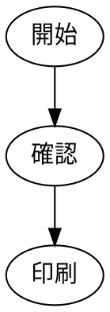
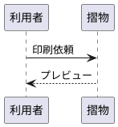

# Surimono サンプル

気軽に開いて読むための架空の文書です。

## 買い物メモ

- ノート
- 鉛筆
- 消しゴム

| 品物 | 個数 |
| --- | ---: |
| ノート | 2 |
| 鉛筆 | 3 |

```swift
let message = "こんにちは、摺物"
print(message)
```

> まずは一枚、試しに刷ってみましょう。

## Graphviz と PlantUML




